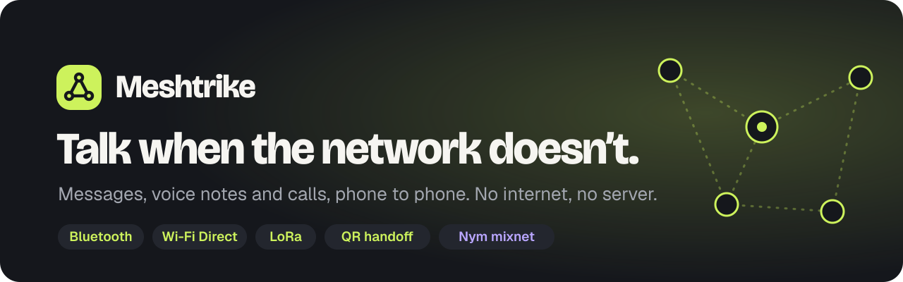
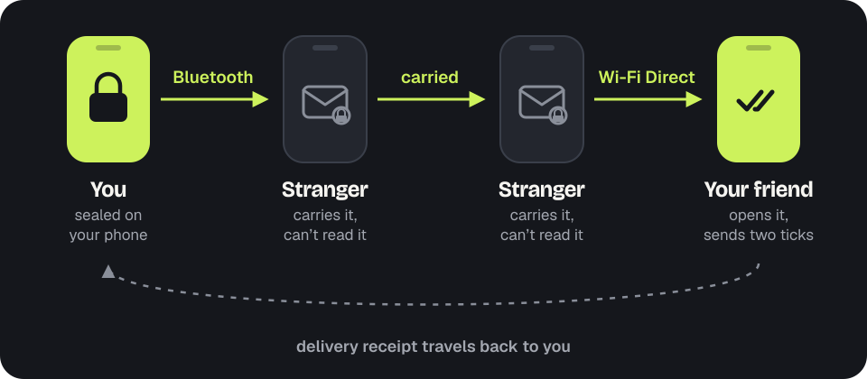

<p align="center">
  
</p>

<p align="center">
  <a href="https://meshtrike0.github.io"><b>Website</b></a> ·
  <a href="https://meshtrike0.github.io/whitepaper.html"><b>Whitepaper</b></a> ·
  <a href="https://meshtrike0.github.io/download.html"><b>Download</b></a> ·
  <a href="https://meshtrike0.github.io/verify.html"><b>Verify your download</b></a> ·
  <a href="ROADMAP.md"><b>Roadmap</b></a>
</p>

<p align="center">
  
  
  
  
  <a href="LICENSE"></a>
</p>

**Meshtrike is an end-to-end encrypted messenger for when the network is down.** Phones talk directly to each other over Bluetooth and Wi-Fi Direct, and carry sealed messages for one another until they reach the right person. No phone number, no account, no server, and the app itself never touches the internet.

It is built for festivals where the tower is overloaded, for protests where networks get cut, for storms that take the power down first, and for trails and boats far from any signal.

## Features

| | |
|---|---|
| 💬 **Messages that find their way** | Text, photos, files and replies. If the person is out of range, nearby phones carry the sealed message for up to 72 hours and up to 7 hops. |
| 🎙️ **Voice notes** | About 120 KB a minute, so they travel well over Bluetooth and the mesh. Pause, review, then send. |
| 📞 **Nearby voice calls** | One-to-one calls over Bluetooth or Wi-Fi Direct with fresh keys every call. No tower involved. |
| 👥 **Groups and public channels** | Private groups of up to 50, plus public channels anyone nearby can read. |
| ⏱️ **Disappearing messages** | From 5 minutes to 4 weeks, timed from when a message is first shown. |
| 📷 **QR handoff** | Radio jammed? Move about 1 MB of sealed messages camera to camera in a few minutes. |
| 📡 **Long range with LoRa** | Pair a small Meshtastic LoRa radio and short texts reach kilometres. |
| 🛡️ **High-Risk mode** | One switch for hostile places: text only, constant cover traffic, LoRa and Wi-Fi off, 24-hour disappearing messages, instant lock. |
| 🔐 **Duress PIN and panic wipe** | A second PIN silently wipes everything and shows a freshly installed app; too many wrong PINs wipe it too. |
| 🧭 **The route pill** | Always shows how a message travels right now: Bluetooth, Wi-Fi, LoRa, internet, or carried by the mesh. |

## How it works

<p align="center"></p>

1. **You write. It's sealed.** Keys live only on your phone. The message is encrypted before it leaves.
2. **Phones pass it along.** Nearby Meshtrike phones carry it, sealed. They can't read it or tell who it's for.
3. **It arrives. Two ticks.** The recipient's phone confirms delivery, and until then the app shows exactly where your message is.

### Routes

| Route | Range | Needs |
|---|---|---|
| Bluetooth | 10–30 m, text instant | Just the app |
| Wi-Fi Direct | 50–100 m, 10–50× faster, calls and big files | The free **MeshGRID** add-on |
| LoRa | Kilometres, short text | A Meshtastic radio |
| QR handoff | Camera to camera | Just the app |
| Internet, private route | Worldwide, through the Nym mixnet | The free **MeshGRID** add-on |
| Carried by the mesh | Grows as people move | Other Meshtrike phones nearby |

## Privacy rules that never bend

- **The app never touches the internet.** Meshtrike doesn't even hold Android's internet permission (checked in CI on every build). All networking beyond Bluetooth lives in a separate, optional add-on, MeshGRID, which only ever carries messages that are already sealed.
- **Notifications carry no names and no content.** "New message", "Incoming call", "Missed call". Never the sender, a preview or a photo.
- **No screenshots.** Every window blocks screenshots and screen recording, and the recent-apps thumbnail is blank.
- **Never says "sent" while it's still on your phone.** A clock means it hasn't left, one tick means it left, two ticks mean their phone confirmed it.
- **Received media is never shown from the original file.** Photos are redrawn from decoded pixels; files and videos are never opened inside the app.
- **Nothing reveals who talks to whom.** No message paths, no hop counts. The app doesn't know them and never stores them.
- **No telemetry, no analytics, no crash reporting.** Checked in CI.

## MeshGRID add-on

MeshGRID is a small, free companion app that adds **Wi-Fi Direct** (faster transfers and calls) and the **private internet route** over the [Nym mixnet](https://nym.com). Keeping it separate means the messenger itself can stay without any internet permission. MeshGRID only serves a Meshtrike app signed with the same release key, and it never sees message contents. Meshtrike works fully without it, over Bluetooth, LoRa and QR.

## Download and verify

<p>
  <a href="https://github.com/meshtrike0/meshtrike/releases/latest/download/meshtrike.apk"></a>
  <a href="https://github.com/meshtrike0/meshtrike/releases/latest/download/meshgrid.apk"></a>
</p>

Android 10 or newer. **Meshtrike** is the messenger; **MeshGRID** is the optional add-on for Wi-Fi Direct and the private internet route. All versions, checksums and signatures: [Releases](https://github.com/meshtrike0/meshtrike/releases). You can also [build from source](docs/DEVELOPMENT.md).

Meshtrike spreads phone to phone, often without internet, which is exactly when a fake copy could be passed along. Every real Meshtrike and MeshGRID APK is signed with one release key that never leaves the team, so **every copy can be checked, however you got it**.

**In your browser, on a phone or a computer:** open the [verify page](https://meshtrike0.github.io/verify.html) and pick the APK. It checks the signature with the same maths Android uses and compares the signing key with the official fingerprint below, then says **REAL** or **NOT REAL**. The file never leaves your device.

**On a computer, one command** (in the folder with the APK):

```bash
sh verify.sh meshtrike.apk meshgrid.apk
```

`verify.sh` is in this repository and attached to every release. Inside the app, *Settings → About & limits → Verify this app* shows the fingerprint of the copy you're running.

| Release key | Fingerprint |
|---|---|
| APK signing certificate (SHA-256) | `AB:09:7B:F4:3C:9B:63:0F:06:67:02:E0:61:9A:60:43:05:13:6A:D2:D6:4B:AA:38:E7:62:2F:AF:17:09:AD:3E` |
| OpenPGP release key | `79E2 783E D581 74B7 3393 FE0F 79A5 F1F0 4F2D EA99` |
| minisign public key | `RWSC18AkPYb7l9TWSVy8CzBHwL/ZqkM7aXeAqeLlLHhsKDeoAaiZ463t` |

The same values are on the [verify page](https://meshtrike0.github.io/verify.html), in the whitepaper and in every release. Step-by-step manual checks (checksums, OpenPGP like Tor, minisign, apksigner) are on the verify page.

## FAQ

**Can one APK be installed on many phones?**
Yes. One APK file works on any number of Android phones. Share it phone to phone (Nearby Share, Bluetooth, USB stick, anything); nobody has to download it from here. Each install creates its own keys on that phone. Because the signature travels inside the file, every copy can still be verified as above, and Android itself refuses to update Meshtrike from an APK signed by anyone else.

**Is everything open source?**
Yes: the Rust core, the Android app, the MeshGRID add-on, the website and the build and release scripts are all here under Apache-2.0. The only thing not published is the private release signing key, which is what lets you tell a real copy from a fake.

**Does it work on iPhone?**
Not yet. Android only for now; see the [roadmap](ROADMAP.md).

**Can people near me see my messages?**
No. Relaying phones only ever hold sealed envelopes. They can't read them, and they can't tell who sent them or who they're for.

**Has it been audited?**
Not yet. An independent security audit, field tests and a formal protocol model are planned before we call it ready for high-risk use. Until then, treat it as beta software.

## Known limits

- Android only (10 or newer); iOS is deferred.
- Wi-Fi Direct, faster file transfer and the internet route need the MeshGRID add-on; without it, files over 256 KB go only to direct neighbours over Bluetooth.
- LoRa region and transmit power are set on the Meshtastic radio itself.
- Not yet independently audited (see FAQ).

## Contributing and security

- Build, test and project layout: [docs/DEVELOPMENT.md](docs/DEVELOPMENT.md). Design: [`spec/`](spec/) and the [whitepaper](https://meshtrike0.github.io/whitepaper.html).
- Found a security problem? Please report it privately; see [SECURITY.md](SECURITY.md).
- Ideas and bugs: [open an issue](https://github.com/meshtrike0/meshtrike/issues).

## License

[Apache License 2.0](LICENSE). Third-party components of MeshGRID are listed in [`plugins/link/NOTICE.md`](plugins/link/NOTICE.md).

<p align="center"><sub>Made by the Meshtrike team.</sub></p>
