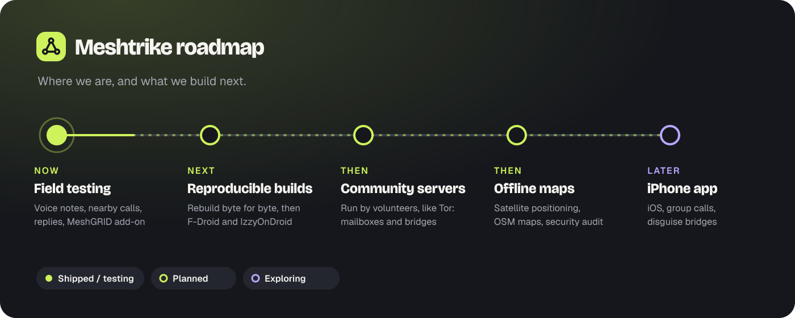

  

# Roadmap

Meshtrike is built in the open. This page says what already works, what we are doing now, and what comes next, in order. Dates are left out on purpose: we ship a stage when it is ready and tested, not before.

| | Stage | What it means |
|---|---|---|
| 🟢 | **Shipped** | Mesh messaging with delivery states and the route pill, groups (up to 50) and public channels, photos, files and video previews, swipe to reply, QR handoff, LoRa via Meshtastic, disappearing messages, High-Risk mode, duress PIN and panic wipe, the MeshGRID add-on (Wi-Fi Direct and the private internet route over the Nym mixnet) |
| 🧪 | **Now: field testing** | Voice notes, nearby voice calls over Bluetooth and Wi-Fi Direct, reply quotes on voice notes, MeshGRID download flow |
| 🛠️ | **Next: first signed release** | Release keys, signed APKs on GitHub, verification in the browser and with one command, then reproducible builds and F-Droid |
| 🤝 | **Then: community servers** | Meshtrike servers run by volunteers, like Tor relays: mailboxes for offline phones and bridges between distant meshes |
| 🗺️ | **Then: offline maps and an audit** | Maps that work through a shutdown, positions straight from satellites, and an independent security review |
| 🔭 | **Later** | iPhone app, group calls, disguise bridges |

---

## 🧪 Now: field testing

Everything in this stage is built and passes the automated mesh scenarios (27 end-to-end scenarios in the simulator, including calls and voice notes). What is left is real-world testing on many phones at once:

- **Crowds:** 20+ phones in one place, phones walking in and out of range, delivery times and battery use over a full day.
- **Calls:** call quality and reconnects at the edge of Bluetooth range, and the hand-over to Wi-Fi Direct.
- **Battery:** measured cost of relaying for others, with the screen off, over 24 hours.

## 🛠️ Next: the first signed release

1. **Release keys.** One Android signing key for Meshtrike and MeshGRID, plus OpenPGP and minisign keys for the checksums. Kept offline, never in this repository.
2. **Signed APKs on GitHub Releases.** Free to download, no account needed, with `SHA256SUMS` signed twice.
3. **Verification anyone can do.** In the browser on the [verify page](https://meshtrike0.github.io/verify.html) (the file never leaves the device), with one command (`sh verify.sh`), or by hand like Tor Browser.
4. **Reproducible builds.** Anyone can rebuild the exact same APK from this source and compare it byte for byte.
5. **F-Droid and IzzyOnDroid.** Listing in the open-source app stores, which build from source themselves.

## 🤝 Then: community servers run by volunteers

Meshtrike works with no servers at all, and it always will. But when a phone in a mesh does reach the internet, volunteer-run servers can make messages travel much further, the way Tor relies on relays run by its community.

- **Mailboxes.** A server holds sealed messages for a phone that is offline, and hands them over when that phone (or any phone carrying for it) comes back online.
- **Bridges between meshes.** Two separate meshes, in two towns or two countries, exchange sealed messages through servers whenever any phone in each of them has internet, through MeshGRID.
- **Disguise bridges.** Later, servers that make the internet route look like ordinary web traffic where the Nym mixnet is blocked.
- **They see nothing useful.** Servers only ever handle sealed envelopes: no message contents, no contact lists, no record of who talks to whom. Phones never depend on one particular server.
- **Easy to run.** One small program or container on a cheap server or a home machine, a public list of volunteer servers signed by the team, and clear guidance on the legal and safety side of running one.

Want to run one when it's ready? [Tell us on GitHub](https://github.com/meshtrike0/meshtrike/issues).

## 🗺️ Then: offline maps with satellite positioning

During a shutdown, Google Maps and similar apps stop working: they need servers to draw the map, search and route. Meshtrike's map will need none of that.

- **Position from satellites, receive-only.** The phone's satellite receiver listens directly to several constellations at once: GPS, Galileo, GLONASS, BeiDou, and NavIC in India (where the chipset supports it). No internet, no cell tower, no account. The receiver only listens, so working out your position transmits nothing and reveals nothing.
  - Android: `LocationManager` with `GPS_PROVIDER` only (never the network or fused provider, which can call Google servers), and `GnssStatus` to show which constellations and how many satellites are in use.
  - No A-GPS / SUPL assistance download (it contacts servers). The first fix can take a few minutes, and the app says so.
  - The chat app asks for location only when the map is first opened. It still gets no internet permission.
- **Open maps on the phone.** OpenStreetMap regional extracts as compact vector tiles (PMTiles), drawn on the phone with open-source MapLibre Native. No tile server, no search server; place search runs on the map file itself.
- **Maps travel like messages.** A region is downloaded through MeshGRID while the internet works, or copied phone to phone over Wi-Fi Direct during a shutdown, so one prepared phone can equip a whole group. Map files are public data, so they are integrity-checked with signed hashes rather than encrypted.
- **Share a place, not a trail.** A pin or meeting point is a new sealed message type (coordinates plus a short label) with the usual disappearing timers. Live location is opt-in, time-limited and per contact. Location sharing is off in High-Risk mode.
- **Honest limits, shown in the app.** Satellite signals can be jammed or faked in conflict areas: the app compares constellations, checks that position and time agree, shows accuracy, and warns when signals look wrong. Maps must be on the phone before they are needed. Sharing a position hands it to the people you send it to.

### Independent security audit

Before we call Meshtrike ready for high-risk use: an external security audit of the core and the app, a formal model of the handshake and envelope format (Tamarin), and a public report.

## 🔭 Later

### iPhone app

The core is portable Rust with no Android-specific code, and its app bindings come from UniFFI, which generates Swift as well as Kotlin, so messages, encryption and storage can be shared with the Android app. The work is in the radio layer, where iOS is much stricter than Android:

- **Bluetooth in the background.** iOS limits what an app can advertise and scan for while it is in the background, which makes background discovery between iPhones and Android phones unreliable. The first iPhone version will work fully while the app is open, and carry messages in the background where iOS allows it.
- **No Wi-Fi Direct on iPhone.** Fast transfers and calls between iPhones would use Apple's peer-to-peer Wi-Fi (Multipeer Connectivity); between an iPhone and an Android phone, Bluetooth.
- **Same messages, same safety.** An iPhone and an Android phone will talk to each other with the same sealed envelopes, contacts and safety numbers. The no-screenshot rule, content-free notifications and High-Risk mode come with it.
- **Getting it onto phones.** Through the App Store, and through alternative app marketplaces where those are allowed.

### Group calls

Calls with several people nearby, over Wi-Fi Direct first, with fresh keys for every call.

### Disguise bridges

Ways for the internet route to look like ordinary web traffic where the Nym mixnet is blocked. In the app this already shows as "Coming soon".

---

## How you can help

- **Run a community server** when they launch (see above).
- **Test it.** Use Meshtrike with friends, at an event, on a hike, and tell us what broke: [open an issue](https://github.com/meshtrike0/meshtrike/issues).
- **Review the code and the design.** The [whitepaper](https://meshtrike0.github.io/whitepaper.html), the [specification](spec/) and the [developer guide](docs/DEVELOPMENT.md) are all public. Security problems go through [private reporting](SECURITY.md).
- **Translate.** Meshtrike should speak the languages of the people who need it most.

Made by the Meshtrike team.

